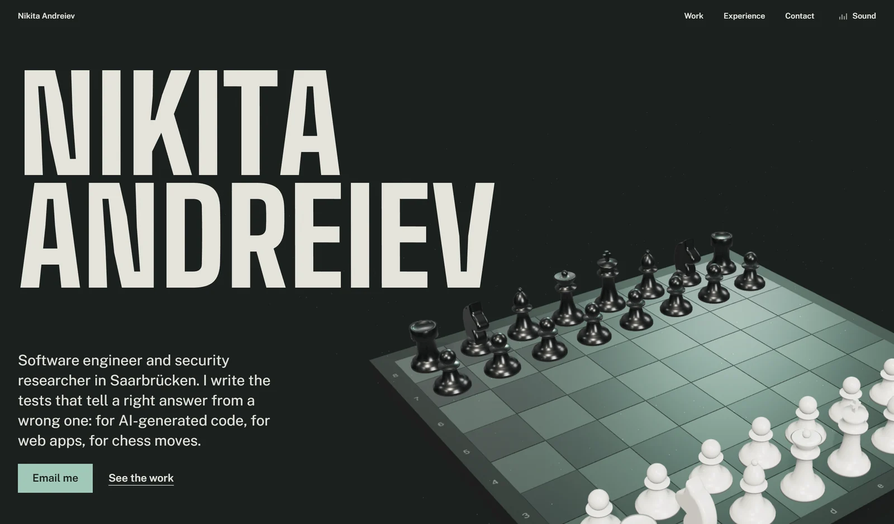

**[Portfolio](https://barabosik.github.io)** · [LinkedIn](https://www.linkedin.com/in/nikita-andreiev) · [thezloynikitan@gmail.com](mailto:thezloynikitan@gmail.com)

### Things I built

- **[Chess Analyzer](https://barabosik.github.io/chess-analyzer/)**. Full Stockfish 18 game review in the browser through WebAssembly. Import from Chess.com or Lichess, get every move classified with accuracy by phase and live engine lines. Nothing leaves your device. [Source](https://github.com/Barabosik/chess-analyzer)
- **[TETHER](https://barabosik.github.io/tether-demo/)**. Grapple-swing precision platformer in a single HTML file. Nineteen hand-tuned levels across three worlds, ghost replays and a level editor. [Source](https://github.com/Barabosik/tether-demo)
- **[Portfolio](https://barabosik.github.io)**. three.js chess board that plays Morphy's Opera Game as you scroll, with GSAP motion and synthesized sound. [Source](https://github.com/Barabosik/Barabosik.github.io/tree/source)
- **[Video compressor](https://github.com/Barabosik/python-video-compressor)**. Python GUI that shrinks any clip to a target file size with FFmpeg.
- **[Telegram AI bot](https://github.com/Barabosik/Telegram-AI-Bot)**. A Telegram bot that talks to a language model.

### Work with

Java and Spring Boot · Python · TypeScript and JavaScript · SQL and PostgreSQL · WebAssembly and Web Workers · Docker and Linux · JUnit and pytest · REST and GraphQL

Ukrainian, Russian, English, German. Open to remote work in security, evaluation or backend.
