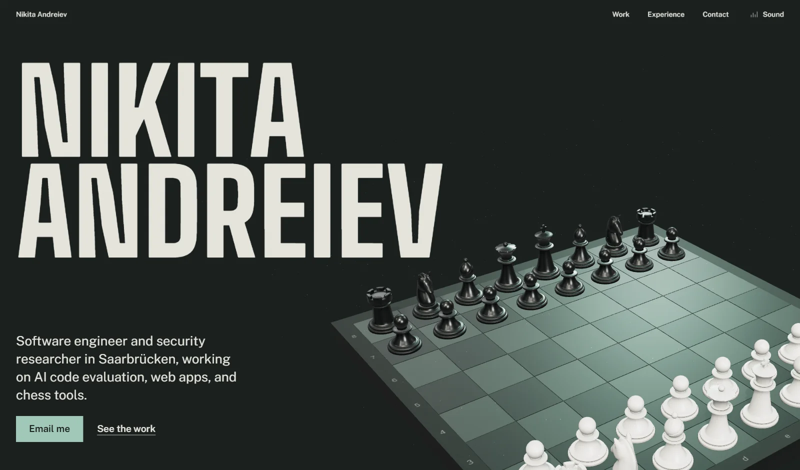

Software engineer in Saarbrücken. Backend for five years, now AI code evaluation and security testing.

[Portfolio](https://nikita-andreiev.com) · [LinkedIn](https://www.linkedin.com/in/nikita-andreiev) · [thezloynikitan@gmail.com](mailto:thezloynikitan@gmail.com)

### Things I built

- [one-shot-site](https://nikita-andreiev.com/one-shot-site/): an agent skill that asks a few multiple-choice questions, then builds a finished website, checks it in a real browser and puts it online. [Code](https://github.com/Barabosik/one-shot-site)
- [p3n](https://nikita-andreiev.com/p3n/): I redesigned the [p3n.si](https://p3n.si/) site and built its apps for Chrome, Firefox, Word, Excel, Google Docs, VS Code, Obsidian and Sublime Text. All of them: [nikita-andreiev.com/p3n](https://nikita-andreiev.com/p3n/).
- [Chess Analyzer](https://nikita-andreiev.com/chess-analyzer/): Stockfish 18 game review that runs in your browser. [Code](https://github.com/Barabosik/chess-analyzer)
- [TETHER](https://nikita-andreiev.com/tether-demo/): a grapple-swing platformer in one HTML file. [Code](https://github.com/Barabosik/tether-demo)
- [Portfolio](https://nikita-andreiev.com): a three.js chess board that plays the Opera Game as you scroll. [Code](https://github.com/Barabosik/Barabosik.github.io/tree/source)
- Smaller ones: a [video compressor](https://github.com/Barabosik/python-video-compressor) and a [Telegram AI bot](https://github.com/Barabosik/Telegram-AI-Bot).

I mostly write Java, Python, TypeScript and SQL, speak Ukrainian, Russian, English and German, and I'm open to remote work.
